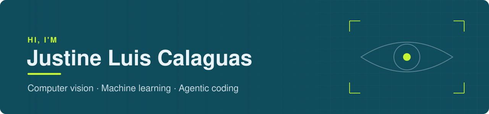

  
  
  

## About

I'm a Computer Science student at Holy Angel University in Pampanga, expecting to graduate in 2027. Most of what I build runs on real input: camera feeds, audio clips, live data.

I also build with AI coding agents. I plan the work, the agents help write it, and I review and test what they produce. My BingeLog repo has a full log of which parts were AI-assisted and which were mine.

**Currently learning:** data analytics and data science, building on the pandas, SQL and R I've used in past projects.

## Projects

### [Driver Drowsiness Detection](https://github.com/kurtzk10/drowsiness-detector)
CS THESIS · TEAM PROJECT

An offline system that watches a driver's eyes and raises an alert before they nod off: camera to laptop to an Android alarm, no internet needed. I trained the eye classifier from scratch on 190,490 eye images, reaching 87.3% subject-independent accuracy with a 5.54% false-alarm rate.

`Python` `PyTorch` `OpenCV` `MediaPipe`

### [Speech Command Recognition with RL Threshold Tuning](https://github.com/JCalaguas/speech-command-rl-threshold)
INTELLIGENT SYSTEMS · TEAM PROJECT

A CNN classifies spoken commands from Mel spectrograms, and a Q-learning agent learns when the model is confident enough to act. It finishes with a per-speaker fairness check.

`Python` `TensorFlow` `Keras` `librosa`

### [BingeLog](https://github.com/JCalaguas/Bingelog)
SOLO PROJECT

A tracker for the anime and TV I'm watching. It pulls show details from TVMaze, then keeps my own episode progress, status, ratings and notes.

`React` `Vite` `Express` `PostgreSQL` `Docker`

### [Portfolio](https://jcalaguas.github.io/Portfolio/)
SOLO PROJECT

My personal site, written in plain HTML, CSS and JavaScript and hosted on GitHub Pages.

`HTML` `CSS` `JavaScript`

<b>Other team projects</b>

 

- **[HAUtogo](https://github.com/qwertyuipaas/HAUtogo):** a campus app that shows where professors are in real time using geofencing. I was the system tester.
- **[Sleep vs. Productivity Simulation](https://github.com/Ryence07/IMODSIM):** a System Dynamics model of how sleep affects productivity, with a web tracker. I was a researcher and helped build and validate the simulation.
- **HAUPokemon:** a distributed monster-tracking system on AWS EC2. I handled EC2 setup and deployment. The AWS environment has since been shut down, so there's no link.

## Toolbox

<picture>
  <source media="(prefers-color-scheme: dark)" srcset="https://skillicons.dev/icons?i=py%2Cjava%2Cjs%2Chtml%2Ccss%2Cbash%2Cr&theme=dark">
  
</picture>
 
<picture>
  <source media="(prefers-color-scheme: dark)" srcset="https://skillicons.dev/icons?i=pytorch%2Ctensorflow%2Copencv%2Csklearn&theme=dark">
  
</picture>
 
<picture>
  <source media="(prefers-color-scheme: dark)" srcset="https://skillicons.dev/icons?i=react%2Cvite%2Cnodejs%2Cexpress%2Cpostgres%2Cmysql%2Csupabase%2Cdocker&theme=dark">
  
</picture>
 
<picture>
  <source media="(prefers-color-scheme: dark)" srcset="https://skillicons.dev/icons?i=aws%2Cgit%2Cgithub%2Cvscode%2Candroidstudio&theme=dark">
  
</picture>

Also: MediaPipe, librosa, pandas, Google Colab

## Certifications

- CCNA: Introduction to Networks · Cisco · 2026
- AI Fundamentals with IBM SkillsBuild · 2026
- Relational Database · freeCodeCamp · 2025
- Responsive Web Design · freeCodeCamp · 2024
